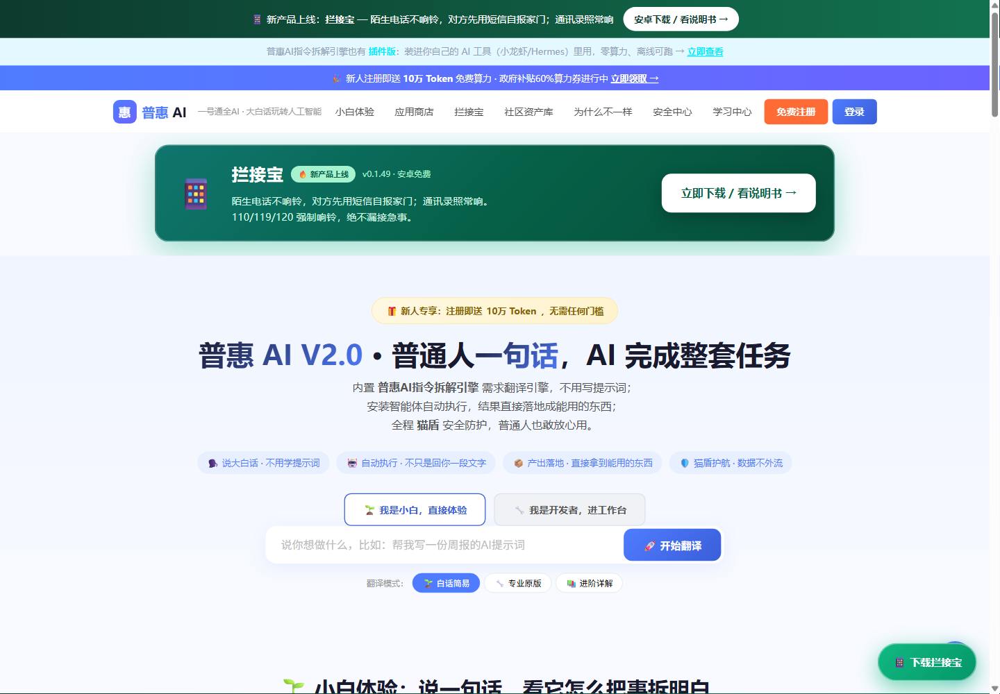
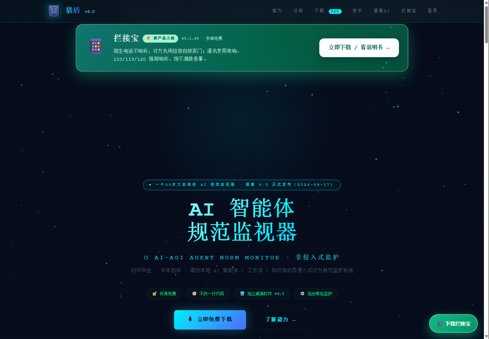

# 普惠 AI 全产品线 · 官方发布仓库

> **普惠 AI，让普通人也能轻松驾驭人工智能。**
> 本站收录普惠AI自研的四款产品，全部提供**功能介绍 + 完整使用说明书 + 可下载安装包**。

[](https://puhuiai.com.cn)
[](https://catshield.cn)
[](#-授权说明)

---

## 📦 四个产品，一张表看懂

| 产品 | 一句话 | 平台 | 下载 | 说明书 |
|:--|:--|:--|:--|:--|
| 📱 **拦接宝** | 陌生电话不响铃，对方先用短信自报家门；通讯录照常响 | Android 10+ | [`lanjiebao-v0.1.49.apk`](../../releases/latest) · 3.5 MB | [查看](products/lanjiebao/README.md) |
| 🛡️ **猫盾 4.0** | AI-AGI 智能体规范监视器：不改一行代码，7×24 外部监护本地 AI | Windows 10/11 x64 | [`maodun-setup-v4.0.0.exe`](../../releases/latest) · 8.1 MB | [查看](products/maodun/README.md) |
| 🗣️ **普惠AI 指令拆解引擎** | 把"大白话"翻译成 AI 能执行的精确指令，294 条术语生活化解释 | Windows / 网页 | [`puhuiai-chaijie-v4.0.0.exe`](../../releases/latest) · 24 MB | [查看](products/puhuiai/README.md) |
| 🦞 **龙虾 Pro 3.0** | 四级仿生 AGI 引擎：化学池 + 十二子系统 + 九大能源粒子 | Windows + Python 3.10+ | [`lobster-pro3.0-engine.zip`](../../releases/latest) · 25 KB 源码包 | [查看](products/lobster/README.md) |

> 💡 全部安装包集中在 **[Releases 页](../../releases/latest)**，点开即可下载，无需注册。

---

## 🖼️ 两个官网长什么样

| 普惠 AI 全民智能服务平台 | 猫盾 AI 安全官网 |
|:--|:--|
| [](https://puhuiai.com.cn) | [](https://catshield.cn) |
| puhuiai.com.cn | catshield.cn |

> 截图取自 2026-10-21 实际线上页面（含顶部「拦接宝」通栏与首屏产品大卡片）。

---

## 🌐 两个官方站点

| 站点 | 地址 | 一句话 |
|:--|:--|:--|
| **普惠 AI 全民智能服务平台** | **[puhuiai.com.cn](https://puhuiai.com.cn)** | 中国版简化 AI 开源社区（小白版 GitHub）：不懂代码、不用注册 API、不用部署，一句话玩转全网 AI |
| **猫盾 AI 安全官网** | **[catshield.cn](https://catshield.cn)** | 猫盾产品官网 + 下载中心 + 全网实时安全评分 |

🆕 两个站点均已上线「**拦接宝**」下载入口：`puhuiai.com.cn/dl/` · `catshield.cn/dl/`

---

## 🎯 这套产品解决什么问题

普通人和小商家想用 AI，卡在三道门槛上：

| 门槛 | 表现 | 我们的答案 |
|:--|:--|:--|
| **不会说"AI 话"** | 提示词、参数、术语看不懂，问一句答一堆废话 | 普惠AI 指令拆解引擎：说人话，自动翻译成可执行指令 |
| **不敢让 AI 跑起来** | 智能体乱读文件、乱删知识库、乱外发数据，没人管 | 猫盾 4.0：非侵入式外部监护，七条底线 + 四级处置 |
| **被骚扰电话困住** | 每天三五通推销/诈骗，接了闹心、拒了漏事 | 拦接宝：陌生号先问询，通讯录直通，110/120 永不拦 |
| **自己搭不起来** | 装环境、配 API、连工具链，普通人到此为止 | 龙虾 Pro 3.0：四级仿生引擎 + 一键装配脚本 |

---

## 📚 每个产品都带什么

每份产品文档都包含 **五段固定结构**，一页读完就能上手：

1. **这是什么** —— 一句话定位 + 适用人群
2. **核心功能** —— 逐条写清能做什么、不能做什么
3. **工作原理** —— 大白话 + 技术口径两层，不吹牛
4. **操作使用说明书** —— 从下载到出结果，一步不落
5. **常见问题** —— 真实踩过的坑

---

## ⚖️ 授权说明

| 项目 | 说明 |
|:--|:--|
| **个人使用** | 全部产品对个人用户 **免费**（猫盾终身免费、永久升级） |
| **源码** | 闭源专有（龙虾 Pro 3.0 提供引擎架构源码包，非全量商业代码） |
| **商用** | 请联系作者授权 |
| **禁止** | 二次售卖、去除品牌标识后分发、用于诈骗/骚扰/侵犯他人隐私 |

## 🧾 关于作者

- 开发者：汪君（湖北赤壁，1977 年生，旅游行业从业者，自学 AI）
- 主体：广州智游蜂网络服务有限公司
- 理念：**初中毕业也能做 AI 产品，普通人也能用好 AI**
- 联系：官网在线客服 · 猫盾官网 130-7887-3632

---

## 📁 仓库结构

```
.
├── README.md                     ← 你正在看的这一份
├── docs/
│   └── 官网与平台信息.md           ← 两个站点的完整信息
└── products/
    ├── lanjiebao/README.md        ← 拦接宝：功能 + 原理 + 五步说明书
    ├── maodun/README.md           ← 猫盾 4.0：功能 + 原理 + 说明书
    ├── puhuiai/README.md          ← 普惠AI 引擎：功能 + 原理 + 说明书
    └── lobster/README.md          ← 龙虾 Pro 3.0：架构 + 安装说明书
```

---

## 🚀 国内下载更快的通道

GitHub 在国内访问偶尔慢，两个官网都提供**国内加速下载**（阿里云上海节点，HTTPS）：

| 产品 | 国内下载地址 |
|:--|:--|
| 📱 拦接宝 APK | https://puhuiai.com.cn/dl/ · https://catshield.cn/dl/ |
| 🛡️ 猫盾 4.0 | https://catshield.cn （首页「下载」区）|
| 🗣️ 普惠AI 引擎 / 插件 | https://puhuiai.com.cn/store |
| 🦞 龙虾 Pro 3.0 | https://puhuiai.com.cn/store |

---

⭐ 如果这些工具帮到你，点个 Star；有问题去官网找客服，或者在 Issues 里提。
