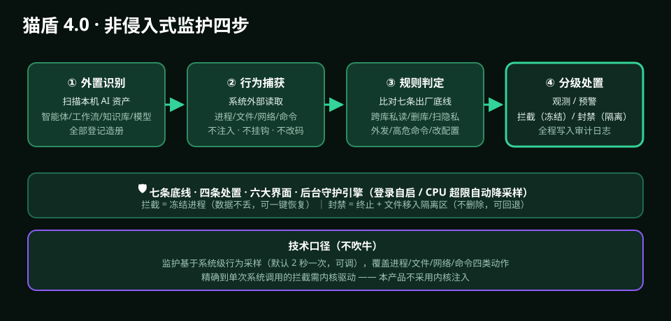

# 🛡️ 猫盾 4.0 · AI-AGI 智能体规范监视器（Windows）

> **不改一行代码，像门外的摄像头一样，看着你的 AI 干活。**
> 本地 AI 智能体 / 工作流 / 知识库的非侵入式行为规范监护系统。

| 项目 | 值 |
|:--|:--|
| 版本 | v4.0.0（2026-09-17 发布） |
| 平台 | Windows 10 / 11 x64 |
| 大小 | 8.1 MB（安装器自动配置运行环境） |
| 价格 | **终身免费 · 永久使用 · 免费升级** |
| 下载 | [Releases → `maodun-setup-v4.0.0.exe`](../../../releases/latest) |
| 官网 | **[catshield.cn](https://catshield.cn)** |
| 独立仓库 | [github.com/chaojiguobao/maodun](https://github.com/chaojiguobao/maodun) |



> 图示：外置识别 → 行为捕获 → 规则判定 → 分级处置，全程不注入、不改一行代码。

---

## 一、这是什么

你在本机跑一堆 AI 智能体（写代码的、跑工作流的、管知识库的）。它们很能干，但也可能：

- 跨智能体偷读别人的私有知识库
- 删掉你几个月攒的知识库文件
- 批量扫描隐私文件、把数据外发出去
- 执行 `rm -rf`、`del /s` 这类高危命令
- 偷偷改工作流规则、改其它智能体的配置

**猫盾不阻止你用 AI，它只在你身边装一台"监控"，让 AI 的动作全程可见、可审计、可追责。**

核心差异：**非侵入式** —— 不注入进程、不挂钩、不改任何智能体一行代码。它从系统外部读取行为（进程启停、文件读写删移、网络外发、系统命令），所以**装完之后你的 AI 该怎么跑还怎么跑，速度不受影响**。

## 二、核心功能

### 1. AI 资产自动识别
安装后全盘扫描，自动识别本机全部 **AI 智能体进程 / 工作流文件 / 知识库目录 / 模型目录**，归类建档；新装的智能体会在增量扫描后自动纳入监护清单。

### 2. 7×24 外置行为监听
纯外部捕获四类动作：

| 类别 | 捕获内容 |
|:--|:--|
| 进程 | 启动、退出、子进程、命令行 |
| 文件 | 读、写、删除、移动、跨目录 |
| 网络 | 外发连接、目标域名/IP |
| 命令 | 高危系统命令调用 |

### 3. 七条出厂底线（逐条可视化开关）

| # | 底线 | 防的是什么 |
|:--|:--|:--|
| 1 | 禁跨智能体读私有知识库 | A 智能体偷看 B 的知识库 |
| 2 | 禁删知识库文件 | 误删/恶意删除长期积累 |
| 3 | 禁批量扫隐私文件 | 全盘扫描通讯录、照片、文档 |
| 4 | 禁无授权外发数据 | 把你的资料传到外部服务器 |
| 5 | 禁执行高危系统命令 | `format`、`del /s`、注册表篡改 |
| 6 | 禁篡改工作流规则 | 偷偷改你的自动化流程 |
| 7 | 禁私改其它智能体配置 | 改别人的 API Key、模型设置 |

### 4. 四级规范处置（每条规则可单独设定力度）

| 级别 | 名称 | 行为 | 适用 |
|:--|:--|:--|:--|
| 1 | 📝 **观测** | 仅记录日志 + 仪表盘提示，不阻断 | 低风险，先观察 |
| 2 | 🔔 **预警** | 实时弹窗告警 + 写安全事件，询问你是否处理 | 中风险 |
| 3 | ⛔ **拦截** | 立即**冻结**违规进程（动作当场停住，不丢数据，可一键恢复） | 高风险 |
| 4 | 🚫 **封禁** | 终止进程 + 涉事文件移入**隔离区**（不删除，可回退） | 极危 |

> 技术口径（不吹牛）：监护基于系统级行为采样（默认 2 秒一次，可调），覆盖进程/文件/网络/命令四类动作。
> 精确到"单次系统调用"的拦截需要内核驱动，本产品**不采用内核注入** —— 所以「拦截」的语义是**把违规进程冻结下来**，不是伪造一次调用被丢弃。

### 5. 六大可视化界面

1. 总览仪表盘（今日事件、风险趋势、资产总览）
2. AI 资产管理中心（智能体 / 工作流 / 知识库 / 模型）
3. 规范规则设置中心（七条底线 + 处置力度逐条调）
4. 实时监控台（滚动行为流）
5. 安全日志与审计报告（可筛选、可导出 HTML/文本）
6. 系统设置与关于

### 6. 后台守护引擎
无窗口常驻、登录后 30 秒自动拉起；关掉界面窗口监护照常运行；引擎 CPU 超上限自动降采样，并提供监听强度调节，绝不拖慢你跑本地大模型。

## 三、工作原理（非侵入式四步）

```
① 外置识别      扫描本机 AI 资产并建档
                 （智能体进程 / 工作流文件 / 知识库目录 / 模型目录）
        ↓
② 行为捕获      从系统外部读取进程的文件访问、网络连接、
                 子命令与生命周期 —— 不注入、不挂钩、不改代码
        ↓
③ 规则判定      每条行为送进规范引擎，比对七条底线
                 与跨知识库关系，判定风险等级与命中规则
        ↓
④ 分级处置      按你设定的力度执行 观测/预警/拦截/封禁，
                 全过程证据写进可导出的审计日志
```

## 四、操作使用说明书

### 第一步 · 下载与安装（3 分钟）

1. 下载 `maodun-setup-v4.0.0.exe`
2. 双击运行；Windows 提示"未知发布者"时点「更多信息 → 仍要运行」
3. 选择安装目录（建议非 C 盘，例如 `D:\Maodun4`）
4. 安装完成，桌面出现猫盾图标

> Win7 用户不支持（需 Windows 10 及以上）。

### 第二步 · 首次启动（授权与扫描）

1. 双击桌面图标
2. 首次启动会做一次**全盘资产扫描**（1–3 分钟，取决于磁盘大小）
3. 扫描完成后进入「总览仪表盘」，此时监护已开始
4. 如需开机自启：设置 → 自启 → 勾选「登录后自动启动后台守护引擎」

### 第三步 · 看懂仪表盘（每天扫一眼）

| 区域 | 你要看什么 |
|:--|:--|
| 今日事件数 | 突然暴涨 → 点「实时监控台」看是哪条 |
| 风险趋势 | 红色柱状上升 → 检查是否有智能体在批量读文件 |
| 资产总览 | 新增了你不认识的智能体 → 到「AI 资产管理中心」核实 |
| 最近告警 | 直接点进去看证据（哪个进程、读了哪个文件、什么时候） |

### 第四步 · 按需调规则（关键）

1. 打开「规范规则设置中心」
2. 七条底线逐条可见，**默认全开、默认处置=观测**（只记录不阻断，先观察一周）
3. 观察一周后，把确认会误伤的规则改成「预警」，把确认危险的规则改成「拦截」
4. 建议配置：
   - 个人用户：1/2/4 号底线 → **预警**；3/5 号 → **拦截**
   - 有重要知识库：2 号 → **封禁**
   - 刚开始用：全部先「观测」跑三天

### 第五步 · 处置与恢复

| 处置 | 你怎么恢复 |
|:--|:--|
| 预警 | 弹窗点「知道了」即可，不影响智能体继续跑 |
| 拦截 | 到「实时监控台」点「恢复进程」，动作继续 |
| 封禁 | 到「安全日志」点「从隔离区恢复」，文件回原位（**不是删除**） |

### 第六步 · 导出审计报告

安全日志 → 筛选时间范围 → 「导出」→ 选 HTML（带图表，发给人看）或 TXT（纯文本，存证用）。

### 第七步 · 卸载

设置 → 关于 → 「完全卸载」→ 勾选「同时删除隔离区文件」（谨慎，删了不可恢复）。
建议先导出一次审计报告留档。

## 五、常见问题

**Q1 会不会拖慢我的 AI？**
不会。非侵入式外部采样（默认 2 秒一次），不注入进程、不挂钩子；引擎 CPU 超上限自动降采样。实测常驻占用 CPU <2%。

**Q2 它是杀毒软件吗？**
**不是。** 猫盾是「AI 智能体规范监视器」，管的是 **AI 的行为边界**（能不能跨库读、能不能外发、能不能改配置），不是病毒查杀。杀毒请用专业杀毒软件，两者不冲突。

**Q3 会不会误伤我的正常工作？**
默认处置是「观测」（只记录不阻断），所以第一周不可能影响你。确认规则后再逐条收紧。

**Q4 需要联网吗？**
监护全程本地完成，不上传你的文件内容。仅"安全评分"与版本检查需要联网，可关闭。

**Q5 支持 Mac / Linux 吗？**
v4.0 仅 Windows 10/11 x64。其它平台在规划中。

**Q6 拦截会不会把智能体的数据搞丢？**
不会。拦截 = 冻结进程（数据在内存里保留），封禁 = 文件移入隔离区（不是删除），两者都可一键恢复。

---

## 六、技术规格

| 项目 | 值 |
|:--|:--|
| 产品定位 | 本地 AI 智能体的外部规范监护系统 |
| 产品形态 | 独立 Windows 桌面软件（非插件 / 非智能体内部技能） |
| 监护方式 | 非侵入式外部行为捕获（不改任何智能体代码） |
| 识别能力 | 智能体 / 工作流文件 / 知识库目录 / 模型目录 |
| 处置体系 | 观测 / 预警 / 拦截（冻结进程）/ 封禁（终止 + 隔离） |
| 出厂底线 | 七条（跨库私读 / 删库文件 / 批量扫隐私 / 无授权外发 / 高危命令 / 篡改工作流 / 私改配置） |
| 界面 | 六大页面 · 桌面图标双击打开 |
| 自启方式 | 安装时注册 · 登录后 30 秒自动拉起后台引擎 |
| 性能 | 默认 2 秒采样，可调强度；引擎 CPU 超限自动降采样 |
| 价格 | **永久免费** |

---

📥 **[下载安装包](../../../releases/latest)** · 🌐 **[catshield.cn](https://catshield.cn)**
